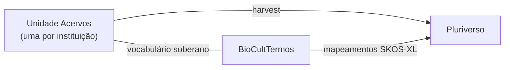

# BioCultAcervos

Registro de evidências da relação de comunidades tradicionais com a biodiversidade, presentes em **acervos históricos e museológicos**.

> **Status**: proposta, sem implementação; aberta a quem quiser assumir. Este repositório contém só documentação — nenhuma tecnologia está definida.

## O que é

Uma visão de como a unidade **Acervos Históricos e Museológicos** da [Arquitetura BioCultural](https://github.com/edalcin/Arquitetura-BioCultural) poderia ser implementada. Guarda a evidência física custodiada por instituições (museus, arquivos, coleções): matérias-primas e artefatos vegetais, exsicatas, peças de coleções etnológicas. Complementa as fontes secundárias ([BioCultDB](https://github.com/edalcin/BioCultDB)), os registros de campo ([BioCultRelatos](https://github.com/edalcin/BioCultRelatos)) e as obras de naturalistas ([BioCultNaturalistas](https://github.com/edalcin/BioCultNaturalistas)).

- **Tipo de fonte**: acervo histórico/museológico; regime enunciativo sempre `evidencia` (ADR-015).
- **Narrativa da comunidade** sobre uma peça não vive aqui: vive no BioCultRelatos da própria comunidade, que referencia o item. As duas descrições coexistem, sem uma sobrescrever a outra.
- **Procedência**: instituição custodiante, número de tombo/registro, data de entrada e, quando conhecida, a cadeia de aquisição — inclusive quando problemática.

## Papel na federação

- Cada acervo membro é uma **unidade soberana**: dados, vocabulário e credenciais próprios, sem compartilhar nada com outro acervo.
- Cada unidade mantém seu vocabulário no [BioCultTermos](https://github.com/edalcin/BioCultTermos); o [Pluriverso](https://github.com/edalcin/pluriverso) unifica os vocabulários por mapeamentos SKOS-XL e coleta os registros pelo contrato de harvest (ADR-016).
- Vocabulário controlado não inclui nomenclatura científica (ADR-014).
- Visão de arquitetura: por ser institucional e as instituições já terem infraestrutura web, esta unidade pode ser uma ferramenta web (ao contrário de BioCultDB, BioCultRelatos e BioCultNaturalistas, vislumbradas como ferramentas stand-alone locais).

## Governança

Seguem integralmente os princípios **C.A.R.E.** (Collective Benefit, Authority to Control, Responsibility, Ethics): a autoridade sobre como o conhecimento tradicional descrito no acervo é registrado e compartilhado permanece com a comunidade de origem, mesmo sem CLPI direto. Como o acervo trata de comunidades que nunca foram consultadas, aplica **Notices** (*Attribution Incomplete*, *Open to Collaborate*) em vez de Labels do Local Contexts; se a comunidade se manifestar, a Notice cede lugar ao Label que ela escolher. Digitalização não é repatriação. Ver a [proposta de governança](https://github.com/edalcin/Arquitetura-BioCultural/blob/main/docs/Governanca/Proposta/propostaGovernanca.md).

## Mais

- Decisão desta unidade: [ADR-001](docs/decisions/ADR-001-integracao-bioculttermos.md)
- Estado e pendências: [docs/proximosPassos.md](docs/proximosPassos.md)
- Contato: [GitHub Issues](https://github.com/edalcin/BioCultAcervos/issues) · edalcin@jbrj.gov.br

## Agradecimentos

A formulação desta proposta não seria possível sem os diálogos e insights de Viviane Fonseca (JBRJ), Lucas Zelesco (FUNAI) e dos membros do Comitê Gestor Useflora, cuja dedicação à salvaguarda da sociobiodiversidade inspirou esta arquitetura.
